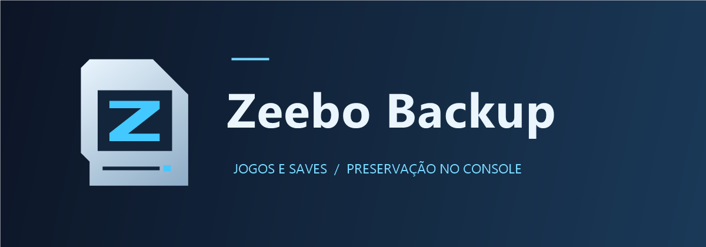
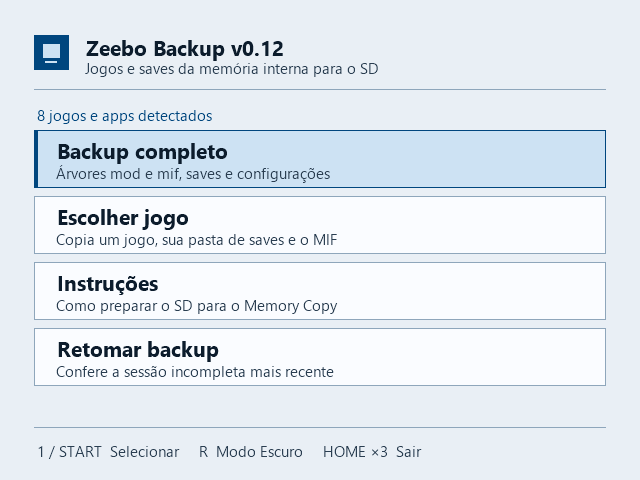
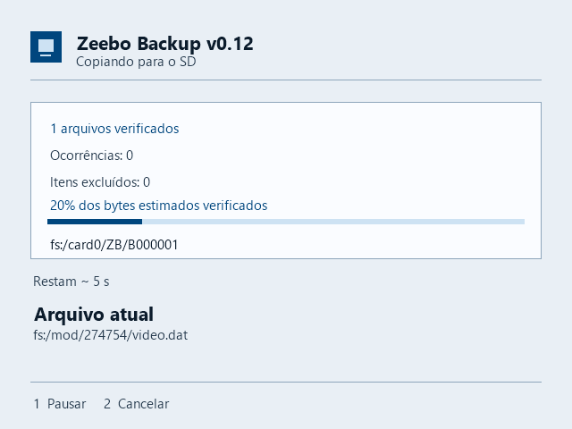

# Zeebo Backup

Aplicativo homebrew independente para copiar jogos, saves e configurações selecionadas da memória interna do Zeebo para o cartão SD. Funciona no console, sem depender de um computador durante a cópia.

## Instalação

1. Em [Releases](../../releases), baixe `zeebo-backup-v0.12.zip`. Esse é o pacote para o console.
2. Extraia `mif/`, `mod/` e `ZB/` na raiz do cartão. Se as pastas já existirem, mescle o conteúdo para preservar os backups.
3. No Zeebo, abra **EMAPPLET → Field Test → Memory Copy**. Aguarde a conclusão, reinicie e abra **Zeebo Backup** no menu de aplicativos.

O pacote foi testado em um Zeebo preparado para homebrew e inclui o descritor BREW com acesso ao SD utilizado no teste. O identificador do aplicativo é `0x01f05a43`. [Instalação de aplicativos pelo Memory Copy](https://www.tripleoxygen.net/wiki/console/zeebo/carregando_seu_codigo)

## Uso

- **Backup completo** copia as árvores `mod/` e `mif/` legíveis, com saves e configurações selecionadas. **Escolher jogo** copia o jogo ou aplicativo selecionado.
- **1** pausa ou continua o backup completo. **2** cancela. **Retomar backup** oferece a sessão incompleta compatível mais recente e verifica as cópias existentes antes de reaproveitá-las.
- **R** alterna entre modo claro e escuro. Pressione **Home** três vezes para sair.
- Cada cópia usa uma pasta `ZB/Bxxxxxx`. O app relê os arquivos no SD para verificar tamanho e CRC32. O `MANIFESTO.TXT` registra os arquivos verificados e as ocorrências. O `ZB/STATUS.TXT` guarda o histórico das sessões.

O backup cobre arquivos que o BREW consegue ler e exclui chaves, PINs, licenças e áreas privadas. Uma sessão **parcial** pode conter arquivos válidos e omissões registradas no manifesto. O aviso **Só zeros** destaca arquivos não vazios cujo conteúdo lido na origem era todo zero. A restauração no console ainda precisa de validação em hardware.

Para conferir um ZIP de backup no PC, use `python -B ./app/conferir_backup.py caminho-do-backup.zip`. Se abrir um issue, informe a versão do app, o modelo ou versão do sistema do Zeebo, os códigos retornados e os trechos relevantes do manifesto. Compartilhe apenas detalhes que possam ser publicados.

## Compilação no Windows

1. Instale ou disponibilize Python 3 e PowerShell. Baixe o [Zig 0.15.2 para Windows x86-64](https://ziglang.org/download/index.json) e extraia o pacote de forma que `zig.exe` fique em `app/.ferramentas/zig-x86_64-windows-0.15.2/zig.exe`.
2. Na raiz do repositório, compile com `./app/build.ps1 -TestarAcessoSd`. Os ZIPs ficam em `app/build/`.
3. Para rodar os testes ARM no PC, coloque o Unicorn 2.1.4 em `app/.ferramentas/emulacao/` com `python -m pip install --target ./app/.ferramentas/emulacao unicorn==2.1.4`. Execute `python -B ./app/testar_backup.py` e `python -B ./app/testar_brew.py`. O teste do inventário para Windows roda com `python -B ./app/testar_pc.py`.

O empacotamento usa o formato BREW observado no SDK, no ZeeUtils e no Zeebx. Os nomes e IDs de jogos usam referências do OpenZeebo e o título do app instalado quando disponível. [Guia de desenvolvimento do Zeebo](https://www.tripleoxygen.net/files/devices/zeebo/doc/ZeeboDeveloperGuide0.97.pdf) · [Catálogo do OpenZeebo](https://www.tripleoxygen.net/wiki/console/zeebo/jogos_e_aplicativos) · [Zeebx](https://github.com/ZeebxTeam/zeebx-emu)
